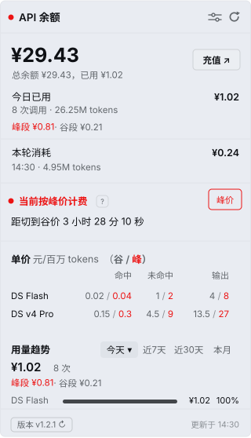
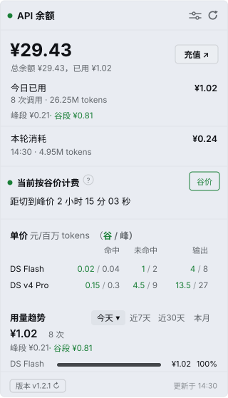

# DS API余额 + 火山方舟额度（balance-float）

DSH Web UI 右下角的悬浮小窗，两个数据源合在一个插件里：

1. **DeepSeek API 余额**：余额、今日已用、本轮消耗、峰谷定价、单价表、用量趋势；
2. **火山方舟额度**：卡片里一行入口，点开是独立可拖动面板 —— 火山账户余额、Agent Plan（近 5 小时 / 近一周 / 近一月）、Coding Plan（会话 / 本周 / 本月）的已用量、总量、百分比与重置倒计时。

Host 半边在本地记账并代理所有外部请求，浏览器半边只读快照渲染；API Key 与 AK/SK 始终不出 Host 进程。

<p align="center">
  
</p>

<table>
<tr>
<td align="center" width="50%">
<br>
<sub>峰价时段（红）</sub>
</td>
<td align="center" width="50%">
<br>
<sub>谷价时段（绿）</sub>
</td>
</tr>
</table>

> 预览图展示的是 DeepSeek 卡片（峰价 / 谷价两态）；火山方舟面板从卡片里的「火山方舟」一行进入。

## 安装

已发布到 npm，在插件管理里输入包名即可：

```text
@lls-a1/dsh-balance-float
```

## 功能

### 余额与用量

- 大号数字是当前 API 余额，点「充值 ↗」跳官方充值页；
- 今日已用 = 0 点余额 − 当前余额（能覆盖其它客户端的花费），并给出调用次数、tokens、峰谷拆分；
- 本轮消耗显示当前这一轮的 tokens 与费用，每轮结算后在胶囊左下浮出「本轮 ¥x」气泡，3 秒自动淡出。

### 峰谷定价

- 峰时：工作日 `09:00–12:00`、`14:00–18:00`；其余为谷时（含周末与法定节假日）；
- 卡片显示「当前按峰价/谷价计费」，**峰=红、谷=绿**，右侧倒计时精确到秒；
- 单价表列出 Flash / Pro 的命中、未命中、输出单价，当前生效的一侧高亮。

### 用量趋势

- 四档窗口：**今天 / 近7天 / 近30天 / 本月**，默认今天；
- 「今天」是个下拉，可回看昨天及更早 6 天；在其它档位点「今天」只切回今天，再点一次才展开下拉；
- 每档都给出：总额、调用次数、**峰段/谷段花费**（红/绿）、按模型的金额与占比条；
- 点柱状图任意一根柱子，打开那天的明细面板（含缓存命中率与 Token 分项）。

### 火山方舟额度

- 入口**默认关闭**，在「外观设置 → 火山方舟设置」里打开「显示火山方舟入口」才出现；
- 必须已配置 AK/SK：未配置时即使开关打开也不显示（配置入口在同一区块）；
- 同一区块里可直接保存 / 清除 AK/SK（写入 DSH 凭据库的 `ARK_QUOTA_ACCESS_KEY`、`ARK_QUOTA_SECRET_KEY`）；
- 面板标题栏可拖动，位置会记住，超出视口自动夹回；`×`、`Esc`、点面板外部均可关闭（无遮罩）；
- 面板顶部显示**套餐到期时间**（Agent Plan / Coding Plan 各一行，含自动续费标记；≤7 天转黄、已过期转红），来源 `GetPersonalPlan`，10 分钟缓存；
- 数据接口（全部走 AK/SK 的 V4 签名 HMAC-SHA256，与火山官方 SDK 的 Authorization 逐字节一致，不读取浏览器登录态）：
  - `billing.volcengineapi.com` · `QueryBalanceAcct`（账户余额）
  - `ark.cn-beijing.volcengineapi.com` · `GetAFPUsage`（Agent Plan，个人版）
  - `ark.cn-beijing.volcengineapi.com` · `GetCodingPlanUsage`（Coding Plan，个人版）
  - `ark.cn-beijing.volcengineapi.com` · `GetPersonalPlan`（套餐档位 / 到期时间 / 自动续费）
- Host 路由：`GET /ark-quota/summary`（60 秒缓存，`?fresh=1` 绕过）、`GET|POST|DELETE /ark-quota/credentials`。

**获取 AK/SK**：火山引擎控制台 → 访问控制 → 访问密钥，创建一对；建议只授予只读权限（费用中心 Billing 只读即可查余额）。

## 操作

| 操作 | 效果 |
| --- | --- |
| 拖动 | 任意位置，位置会被记住；拖到左右边缘 56px 内松手收成小球，只显示余额 |
| 点标题栏 | 收起卡片 |
| 点环形箭头 | 立即刷新（请求中旋转） |
| 点「火山方舟」行 | 打开额度面板；面板独立存在，主卡片收起也不会跟着关 |
| 点版本号 | 检查更新，有新版时提示，升级在插件管理器完成 |
| 点 `?` | 展开/收起峰谷说明 |

卡片自动向上或向下展开（下方空间不足时向上），内容超长时内部滚动。数据每 4 秒刷新，页面回到前台时立即补一次；火山面板 60 秒刷新一次。

## 外观设置

胶囊右侧的滑杆图标打开面板，即时生效并保存在本地：

- **背景透明度** 0–90%、**阴影** 0–100%、**圆角** 0–20px；
- **贴边收成小球**：默认开，拖到屏幕边缘自动收成 46×46 的小方球；
- **火山方舟设置**：显示入口开关 + AK/SK 的保存与清除。

## 数据位置

DeepSeek 账本在 `$DSH_HOME/balance-float/usage.json`（原子写入，损坏自动重建）。首次运行若没有自己的账本，会从旧的 `.dshw-usage.json` 复制一份作种子，之后互不影响。

火山 AK/SK 只存凭据库，不写配置文件；`/ark-quota/summary` 的 60 秒缓存按 AK 做键。

可在 `cordis.patch.yml` 的 `config` 里覆盖 DeepSeek 部分：

```yaml
storeFile: ''          # 账本路径，默认 $DSH_HOME/balance-float/usage.json
legacyFile: ''         # 种子账本，默认 $DSH_HOME/.dshw-usage.json
refreshSeconds: 20     # 余额轮询间隔
apiKeyRef: DEEPSEEK_API_KEY
```

## 限制

- 火山套餐接口只覆盖**个人版**；企业版席位额度（`GetSeatAFPUsage` / `GetSeatInfoUsage`）未接入；
- `/ark-quota/summary` 的缓存按 AK 做键：绕过界面直接改 YAML 换 SK 时，最长 60 秒旧数据；
- 未订阅的套餐显示「当前账号未订阅该套餐」；AK 权限不足会如实报错，不会被当成未订阅；
- 火山账户余额为 0 时显示 `¥0.00`，不代表套餐额度用完（套餐看窗口百分比）。

<a href="https://github.com/deepseek-ai/deepseek-harness"></a>
